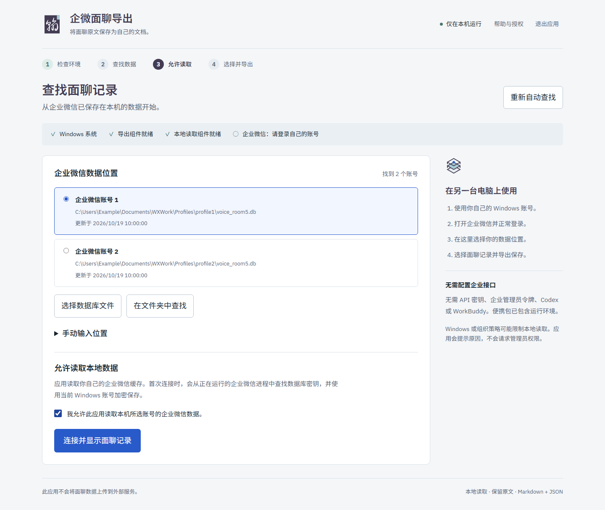

# 企微面聊导出

将企业微信「记录面聊」的**转录原文**导出为 Markdown 和 JSON。直接读取当前账号的本地缓存，保留原始措辞、重复发言和续录片段。无需滚屏、OCR 或反复复制，不占用鼠标和剪贴板。

独立的本地工具，并非企业微信官方产品或官方导出接口。目前支持 **Windows x64**，已验证企业微信 **5.0.12.6018**。客户端更新可能需要适配。

## 下载并使用

1. 从 [Releases](https://github.com/yangpenghan/wecom-transcript-exporter/releases) 下载最新的 Windows x64 ZIP。
2. 完整解压，双击 **WeCom Transcript Exporter.exe**，浏览器会打开中文界面。无需安装 Python、Codex 或 WorkBuddy。
3. 登录自己的企业微信账号，自动查找数据；也可选择文件、文件夹或手动填写位置。
4. 允许本地读取，选择面聊记录及保存位置，点击**导出转录原文**。

如果原文显示“成员 N”，导出前勾选 **使用本地通讯录补全成员姓名**。应用按这条面聊的成员 ID 精确匹配当前账号的本地姓名，不按内容猜人，也不上传通讯录。首次需要单独检查通讯录密钥，可能约一分钟；已有原始姓名不会被覆盖。失败时仍导出原文，并保留成员编号。复制或迁移过的数据库若缺少原账号信息，可能无法补全。



无需企业 API 密钥或管理员令牌。首次连接会在征得同意后检查当前用户的企业微信进程，验证数据库密钥，并由 Windows 加密保存。应用不请求管理员权限；组织策略可能阻止读取。

详见 [便携版使用指南](docs/portable-guide.md)、[验证记录](docs/verification.md) 和 [隐私核查记录](docs/privacy-audit.md)。程序未数字签名，尚未在第二台实体 Windows 电脑上验证。

## 数据与隐私

- 应用不会向外部服务上传面聊数据。界面仅绑定 `127.0.0.1`，使用随机会话授权，字体及脚本均在本地。
- 设置和加密密钥存放在 `%LOCALAPPDATA%\WeComTranscriptExporter`；导出文件存放在你选择的位置。
- **帮助与授权 → 清除本地授权**可移除保存的授权和密钥，不会删除导出文件。
- 仓库与发布包不含真实记录、数据库或用户授权状态，截图与示例使用合成数据。分发时只分享发布 ZIP，不要打包整个工作目录。
- 导出来源为**本地缓存**，无法证明服务端没有更多记录。应用提示消息编号缺口和结束标记缺失等情况；缺失记录请先在企业微信中打开并同步。

## 从源码运行

安装带 Windows 启动器的 64 位 Python 3.13，运行一次 **Setup.cmd**，然后打开 **Start-App.vbs**。已有的本地 `runtime/python.exe` 也可用于安装。**Start-Export.cmd** 为可选命令行入口。

```powershell
# 查看本地面聊列表
.\.venv\Scripts\python.exe native_export.py --list

# 按完整且唯一的标题导出
.\.venv\Scripts\python.exe native_export.py --title '示例面聊标题'

# 可选：按当前账号的本地通讯录补全成员姓名
.\.venv\Scripts\python.exe native_export.py --title '示例面聊标题' --resolve-names

# 指定导出位置，不覆盖已有文件
.\.venv\Scripts\python.exe native_export.py --title '示例面聊标题' --output 'exports/recording.md'

# 多账号或迁移过存储位置时，明确指定数据库
.\.venv\Scripts\python.exe native_export.py --database 'C:\path\to\voice_room5.db'
```

不传 `--title` 时显示编号列表，直接回车取消。命令行状态存放在 `.native-state/`。姓名缺失时使用固定的“成员 N”标注；可通过 `--speaker-map exports/names.json` 提供本地姓名映射，请勿提交该文件。

## 项目结构

| 文件或目录 | 用途 |
| --- | --- |
| `desktop_app.py` | 本机 HTTP 服务、会话及程序入口 |
| `desktop_service.py` | 数据发现、授权、导出 |
| `web/` | 中文界面与离线资源 |
| `native_export.py` | 命令行及本地数据库流程 |
| `native_transcript.py` | 原文解码与 Markdown 生成 |
| `native_contacts.py` | 可选的当前账号成员 ID 到姓名匹配 |
| `native_support/` | 加密、WAL、密钥读取辅助代码及来源 |
| `scripts/build_portable.py` | Windows 发布包构建 |
| `tests/` | 合成数据单元测试与浏览器测试 |
| `docs/` | 使用、架构、验证和发布文档 |

`exports/`、`.native-state/`、`.venv/`、`runtime/`、`.ui-test/`、`.local-archive/`、`build/`、`dist/` 均为本地目录，不纳入 Git。

## 开发验证与构建

```powershell
.\.venv\Scripts\python.exe -m unittest discover -s tests -v
.\.venv\Scripts\python.exe -m pip install -r requirements-build.txt
.\.venv\Scripts\python.exe scripts/build_portable.py
```

构建只包含应用、离线资源及依赖许可证，输出 ZIP 与 SHA-256 校验文件。运行依赖和构建依赖分别锁定于 `requirements-lock.txt` 和 `requirements-build.txt`。

可选浏览器测试需要 Node.js 20+ 和 Playwright 1.62.1：运行 `npm install`、`npx playwright install chromium`，启动下方独立测试实例，然后在另一终端执行 `npm run test:browser`：

```powershell
.\.venv\Scripts\python.exe desktop_app.py --no-browser --session-file .ui-test/session.json --state-dir .ui-test/state
```

测试使用合成 API 结果，不读取真实企业微信数据。应用本身不依赖 Node.js。参见 [参与开发](CONTRIBUTING.md)、[安全反馈](SECURITY.md) 和 [架构与限制](docs/architecture.md)。

## 许可证、来源与发布状态

项目原创代码采用 **[Apache License 2.0](LICENSE)**，署名与来源见 [NOTICE](NOTICE)。第三方代码、字体及依赖继续适用各自许可证。个人标志用于本项目署名，不代表对衍生项目的背书或商标授权。

数据库辅助代码改编自 MIT 许可的 [wecom-agent](https://github.com/freanocank/wecom-agent)。字体及其他依赖遵循各自许可证，详见 [第三方声明](THIRD_PARTY_NOTICES.md)。作者及设计署名保留为公开项目元数据。

公开发布状态与待办见 [公开发布准备](docs/public-release-checklist.md)。
